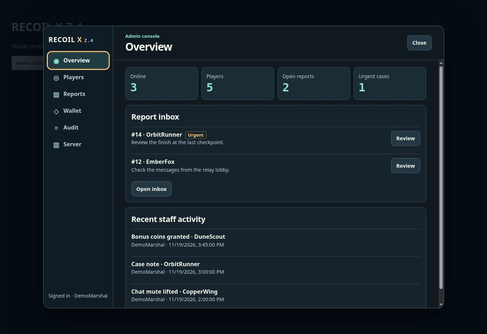

# RECOIL X Z.4 — Project Ascension

Z.4 includes the 50-feature Project Ascension update and a redesigned staff console. It incorporates the existing moderation and bonus-wallet patch from [the current main baseline](https://github.com/RecoilXDev/Recoil-X/commit/dbe0165754f79d5e1034d49c1c6f81d3cb613a58). This is a single development release in [draft PR #9](https://github.com/RecoilXDev/Recoil-X/pull/9). The [release report](docs/ASCENSION_RELEASE.md) covers verification, migration, release checks and rollback.

## Admin console

Sign in through **Friends**, then select **Admin console** on Home or in Friends. The game uses the administrator role on the signed-in account. Overview shows online players, account count, open reports and urgent cases, with shortcuts to the report inbox and recent staff activity. The console loads on demand. A failed asset load opens the original moderation form and allows a retry. A connected gamepad can move focus with the D-pad, activate with A and cancel with B. Confirmations keep controller focus on the decision. Text entry uses the device keyboard.

### 29 things staff can do

| # | Where | Action |
|---:|---|---|
| 1 | Players | Search the player directory by the start of a name and page through results. |
| 2 | Players | List players currently connected to the game server. |
| 3 | Players | List accounts that currently hold the administrator role. |
| 4 | Players | Inspect a player’s role, presence, bonus balance and active restriction reasons and expiry times. |
| 5 | Players | Find accounts with an active ban or chat mute. |
| 6 | Players | Kick a player with a reason. |
| 7 | Players | Issue a temporary ban with an expiry. |
| 8 | Players | Issue a permanent ban with a reason. |
| 9 | Players | Lift a ban. |
| 10 | Players | Apply a timed or indefinite chat mute. |
| 11 | Players | Lift a chat mute. |
| 12 | Players | Send a private warning the recipient can read and acknowledge in Friends. |
| 13 | Players | Leave a staff-only note on a player. |
| 14 | Reports | Triage open, urgent, own, closed or all cases. |
| 15 | Reports | Claim an open case. |
| 16 | Reports | Release your assignment so another admin can take the case. |
| 17 | Reports | Mark a case urgent or return it to normal priority. |
| 18 | Reports | Add an internal case note. |
| 19 | Reports | Inspect a case timeline and linked match events when a report has recorded evidence. |
| 20 | Reports | Resolve a report with a recorded reason. |
| 21 | Reports | Reopen a resolved report and record why. |
| 22 | Wallet | Look up a player’s server bonus balance and recent grant receipts. |
| 23 | Wallet | Grant bonus coins with a reason and a receipt. |
| 24 | Wallet | Reverse a specific grant once and record the correction. |
| 25 | Audit | Filter staff actions by moderator, target player and action group. |
| 26 | Audit | Export the displayed audit results as a JSON file. |
| 27 | Server | Check live player, room and match counts, memory, uptime, median round-trip time, errors and disconnects. |
| 28 | Server | Review flagged movement and open the associated player profile. |
| 29 | Server | Request an integrity-checked private database backup and check its completion or failure. |

The existing kick, ban, mute and bonus-wallet tools are included in the count. Staff changes have a confirmation step. The server checks the saved role on each staff request, keeps audit records and prevents two admins from claiming the same case. A repeated grant request reuses its receipt. Reversing a grant requires enough remaining bonus coins. The older shop still spends the original browser-saved coins.

On shared devices, signing out closes the console and clears the staff view. A late Friends response from the prior account cannot sign the new player out or change their displayed role.

The audit export contains up to 100 matching entries. The ledger shows up to 40 recent grants, and a timeline shows up to 50 recent staff events. Manual database backups run in the existing private worker, with a one-hour request cooldown per running server. Admins can see backup status in the console. Database files and storage paths stay private.

[Console](server/admin-panel.js) · [Server actions](server/admin-patch.mjs) · [HTTP, WebSocket and database tests](tests/z4-admin.test.mjs) · [Signed-in game menu tests](tests/z4-admin-client.test.cjs)

## Playing Project Ascension

Open **Project Ascension** on the home screen. **Multiplayer → Host** starts an online mode. **Training and private maps** opens the solo practice activities. Friends accounts own online progress, clan membership, vault relics and Ascension marks. The private editor and practice personal bests use this browser's local save. Ranked uses the existing competitive rules and rating store. Ascension custom settings apply to hosted matches.

## How to read the checklist

Every row has a named automated case and an implementation location. **PASS** describes the exercised behavior. **PARTIAL** identifies additional acceptance evidence still needed even though the listed local case passed. No physical-device results or production measurements are inferred. In the table, “World” is the [objective and map simulation](server/ascension-world.mjs), “Combat” is the [equipment simulation](server/ascension-combat.mjs), “Match” is the [authoritative match loop](server/overdrive-match.mjs), “Rooms” is the [room service](server/overdrive.mjs), “Store” is the [account ledger](server/ascension-store.mjs), and “Client” is the [existing game entry](index.html).

Run any of the 50 numbered cases by its A-prefix using the commands in the release report. The suite also follows two signed-in players from the home screen into all ten match modes and five world events. It checks hosting, joining, the objective HUD and returning to the lobby. [Match rules](tests/ascension-match.test.mjs) · [Accounts and backups](tests/ascension-services.test.mjs) · [Client controls](tests/ascension-client.test.cjs) · [Player menus](tests/overdrive-client.test.cjs) · [Network tests](tests/ascension-wire.test.mjs) · [Predecessor compatibility](tests/ascension-migration.test.mjs)

### Game modes

| # | Implemented feature and location | Verification |
|---|---|---|
| 1 | Payload Escort. World and Client move an armored convoy along three checkpoints, with a contest radius, time extensions, overtime and a defender stop. | **PASS · A01**. Held a contested convoy, completed its route in overtime and separately won as defender. |
| 2 | Search & Destroy. World alternates sides, channels plant and defuse actions, holds casualties out of the round and awards the first team to three. Match and Client provide teammate spectating. | **PASS · A02**. Planted, eliminated a player, defused, changed sides and restored the roster. |
| 3 | Capture the Flag. World tracks two flags, carriers, drops, owner returns, timed resets and home-base captures. Client shows flags and bases. | **PASS · A03**. Three server-accepted carries and home captures ended the match. |
| 4 | Gun Game. World locks each player to the current weapon in the host's approved order. A confirmed final-weapon elimination ends the ladder. | **PASS · A04**. Advanced through a two-weapon ladder and included the final shot in the recap. |
| 5 | One in the Chamber. Match and World provide a compact field, one initial round, elimination ammo, melee and three lives. | **PASS · A05**. Tested misses, reload refusal, ammo on elimination and last-life victory. |
| 6 | Bounty Hunt. The HUD identifies the leading bounty. World limits bonuses against one victim. Store applies eligibility and a repeat-opponent interval to permanent credits. | **PASS · A06, A23**. Checked increasing bounties, capped repeat bonuses and durable credit deduplication. |
| 7 | Hardcore. A separate room uses 35 health, a reduced HUD and server visibility filtering. | **PASS · A07**. Compared standard health and checked that cover hid an opponent in the server snapshot. |
| 8 | PvP Extraction. Players collect finite cargo, drop loot on elimination and channel at their own exit. Store credits settled results. | **PASS · A08**. Interrupted and restarted extraction, then held the zone again without duplicating cargo. |
| 9 | Parkour Race. Four ordered jump gates save race checkpoints. The first finisher opens a final 12-second window. Account best times appear on the board. | **PASS · A09**. Rejected an out-of-order gate and a grounded crossing, recorded the winner and elapsed time. |
| 10 | Duel Roulette. Both players receive the same random allowed weapon each round. Short rounds reset health and ammo. First to three wins. | **PASS · A10**. Checked identical loadouts, reset, timer and final score. |

### Weapons and combat

| # | Implemented feature and location | Verification |
|---|---|---|
| 11 | Dual wield. Combat equips paired pulse pistols in the rifle slot or paired SMGs. Client alternates hand recoil. Match owns fire cadence, damage, spread and longer shared-magazine reloads. | **PASS · A11**. Checked ammo, timing, reload and holstering on a weapon change. First-person presentation was also exercised in the client tests. |
| 12 | Weapon overheating. Supported automatic weapons build heat, lock, and cool back below the release threshold. Private rules expose an off switch. | **PASS · A12**. Sustained fire locked the weapon, cooling restored it, and a heat-disabled room stayed cool. |
| 13 | Destructible cover. Selected objects have server health. Removing cover updates collision and the client geometry revision. | **PASS · A13**. Shot a barrier, checked the second player's snapshot and walked through its former collider. |
| 14 | Bullet ricochet. Metal surfaces can reflect one ray off a known face. The reflected leg has reduced range and damage. | **PASS · A14**. Measured reflected damage and two tracer segments from one shot. |
| 15 | Advanced Aim Academy. Moving, reflex and accuracy drills track hits, shots, reaction time and a separate best for each drill. | **PASS · A15**. Ran all three drills through their debriefs. Opened moving targets with touch controls in Chrome. |
| 16 | Weapon mastery challenges. The account ledger assigns limited credits to the weapon that earned each qualifying elimination. At 3, 10 and 25 credits it unlocks finish tiers. | **PASS · A16**. Replayed the same settled match and verified the weapon and account received credit just once. |
| 17 | Melee parry. Combat verifies facing, proximity and sight. A short parry window counters melee and briefly stuns the attacker. | **PASS · A17**. Tested a counter, cooldown and a later unprotected strike. |
| 18 | EMP grenades. A projected short-range pulse disables enemy electronic tools for four seconds and breaks shields within the pulse. | **PASS · A18**. Tested gadget suppression, shield removal and cooldown. |
| 19 | Deployable shields. Server placement rejects overlap, validates bounds, permits one active shield per owner and four per room, then handles health and expiry. | **PASS · A19**. Checked placement against a player, repeat placement, movement collision and expiry. |
| 20 | Legendary weapon evolutions. Settings select earned etching, edges or an animated pulse. Non-legendary finishes can use the first mastery accent. Combat values stay server-defined. | **PASS · A20**. Checked all three unlock thresholds, persistence and drawing only the earned stage for the signed-in account. |

### Multiplayer and community

| # | Implemented feature and location | Verification |
|---|---|---|
| 21 | Clans. Store owns unique names and IDs, emblems, invitations, leader/officer/member permissions, rosters, transfer and achievements. | **PASS · A21**. Exercised duplicate names, joining, role denial, promotion, transfer and a three-member achievement. |
| 22 | Clan wars. Leaders register their clans, accept scheduled challenges and fill clan-specific seats. The server records the winner of a qualifying completed match. Interrupted wars can reopen within their start window. | **PASS · A22**. Tested roster and time checks, result settlement and standings. |
| 23 | Rivalries. Store tracks eligible opponent wins and eliminations and throttles repeated pairings. A Roulette host can send an expiring duel invitation. | **PASS · A23**. Verified pair records, grace interval, zero-kill participation and invite expiry. |
| 24 | Custom match rules. Rooms validate health, gravity, weapon order, map, team size and applicable score limit before starting a hosted competition. | **PASS · A24**. Exercised rejected and accepted rules and a disallowed weapon selection. |
| 25 | Team drafting. Captains take balanced turns picking from one roster. Every player confirms before teams lock and the server starts. | **PASS · A25**. Drafted six players, rejected an out-of-turn pick and blocked start until all confirmed. |
| 26 | Broadcast spectators. Read-only viewer seats have a rotating or manual camera. The server binds the view and shot feed to a permitted team's sight. | **PASS · A26**. Switched viewpoints, compared visibility behind cover and verified the observer received no private loadout state. |
| 27 | Match rejoin slots. Accounts retain their match seat during the existing reconnect window. A new socket receives a current keyframe, fresh controls and retained objective state. | **PASS · A27, wire and client rejoin cases**. Rejoined the same 10-player match, tested expiry and resumed a restarted frame sequence. |
| 28 | Server browser. Opt-in public lobbies show mode, arena, players and available slots. Refresh measures round-trip latency to the server. Password rooms and locked rooms stay private. | **PASS · A28**. Created rooms, joined one and verified filtered and locked results against real membership. |
| 29 | Shareable recaps. The result screen copies scores, teams, MVP, K/D, accuracy and highlights. A selectable text fallback works without clipboard permission. | **PASS · A29**. Checked recap contents and verified that an extra private field was absent. |
| 30 | Community challenge board. The goal pair rotates by Oman server date. Qualifying results advance daily progress, with one claim per account and day. | **PASS · A30**. Tested incomplete claims, successful claims, replayed claims and midnight rotation. |

### Maps, bosses and events

| # | Implemented feature and location | Verification |
|---|---|---|
| 31 | Ironline Express. Four connected carriage decks, cover, edge hazards and scrolling scenery give the train motion on fixed collision geometry. | **PASS · A31, mesh test**. Checked deck hazards, stable colliders and finite generated geometry. |
| 32 | Flooded Laboratory. Corridors connect water and air zones. Water slows travel and drains oxygen, then health, until a player reaches air. | **PASS · A32, mesh test**. Simulated oxygen depletion, damage and recovery. |
| 33 | Orbital Slipstream. Directional thrust, inertia and higher jumps use the normal collision and movement controls. | **PASS · A33**. Measured motion after input release, jump height and map bounds. |
| 34 | Volcanic Eruption. A rising lava surface surrounds a moving, shrinking safe zone. Damage increases and surviving the timer awards victory. | **PASS · A34**. Compared safe and exposed players, shrinkage and a survival result. |
| 35 | Titan Mech Raid. Two to four allies open the mech shield on paired seals, avoid targeted strikes or area attacks and face faster attacks below half health. | **PASS · A35**. Tested simultaneous seal use, both attack types and server-confirmed defeat. |
| 36 | Time Fracture. The server alternates future and ruined sections every 12 seconds, inserts or removes cover and publishes the same geometry revision to clients. | **PASS · A36**. Compared both clients and verified restoration of baseline collision. |
| 37 | Map Builder Lite. A private 9×9 editor supports placement, rotation, moving, local save/load, 64 modules, spawn protection, route validation and a playable test. | **PASS · A37**. Exercised editing, validation and play. Also saved, rotated and entered a private map in desktop Chrome. |
| 38 | Hidden puzzle vaults. Ordered rune interactions open a room in supported arenas. The collector must enter and interact to earn a persistent map relic. | **PASS · A38**. Rejected an out-of-order rune, opened the gate and collected separately. |
| 39 | Alien Invasion. Four cooperative waves include scouts, brutes and a boss. Scaling respects team size and bounds active enemies. | **PASS · A39**. Checked wave count, varieties, cap and boss-wave victory with controlled enemy-health fixtures. |
| 40 | World Boss Weekends. Friday and Saturday in Oman share one community damage goal. Server-settled contributions unlock a one-time participant reward. | **PASS · A40**. Tested both weekend boundaries, shared damage across days, repeated settlement and store reopening. |

### Network, operations and accessibility

| # | Implemented feature and location | Verification |
|---|---|---|
| 41 | Server-authoritative hits. Match computes position, aim, collision, damage, cooldown, ammo, protected targets, eliminations and outcomes. Ascension clients submit controls. | **PASS · A41 and existing combat regressions**. Validated actual target health and rejected stale input. |
| 42 | Suspicious movement. The server bounds input and travel, corrects implausible displacement and writes throttled entries for moderator review. Spawn and reconnect start new samples. | **PASS · A42**. Exercised the movement envelope, legitimate spawn changes and alert creation without a ban. |
| 43 | Adaptive updates. The [network encoder](server/ascension-network.mjs) negotiates deltas against a delivered keyframe, omits unchanged objective state, responds to backpressure and periodically refreshes the full view. | **PASS · A43 and wire cases**. Exercised keyframes, changed and removed rows, legacy clients and 2/4/6/10 simultaneous players. |
| 44 | Connection diagnostics. The client reports server RTT, arrival jitter, reconnects and estimated missing application snapshots. WebSocket transport packet loss is unavailable to the browser. | **PASS · A44**. Fed a known frame gap, checked the estimate, and decoded the following delta. |
| 45 | Automatic database backups. The worker verifies each private snapshot, retains migration copies and resumes the schedule after a restart. Failed routine backups retry hourly. An existing database needs a verified snapshot before a schema change. [Backup worker](server/ascension-backup.mjs) | **PARTIAL · A45 and migration rehearsal passed.** Tested retention, restore, timing across restarts, automatic retry and sign-in during a storage fault on a migrated database. The private Alwaysdata restore and disk-capacity check remain open. |
| 46 | Secure account recovery. Authenticated owners re-enter their password to issue an offline recovery code. Recovery consumes its stored digest, sets a newly salted password and revokes sessions. | **PASS · A46**. Tested enrollment, wrong password, valid recovery, single use, revoked sessions and sign-in with the new password. |
| 47 | Input matchmaking. Solo players can select their current input family or cross-input matchmaking. A friend squad can stay together. | **PARTIAL · A47 passed**. Checked input grouping and a simulated controller's movement, triggers, jump and parry. Actual controller hardware remains unverified. |
| 48 | Accessibility Hub. Settings combine text size, HUD scale, reduced motion, directional shot captions, team shapes/colors, high contrast and reduced flashes. | **PARTIAL · A48 passed**. Verified preference persistence and UI state. Physical device, assistive-technology and landscape size checks remain. |
| 49 | Low-RAM streaming. Procedural map chunks retain packed vertices, upload nearby geometry on demand, and evict stale GPU buffers. Map and postprocessing resources are disposed on transitions. | **PARTIAL · A49 passed**. Measured packing and verified buffer, texture, framebuffer and program cleanup with an instrumented renderer. Physical GPU memory, heat and long-session FPS remain unmeasured. |
| 50 | Server health. Authenticated admins can see active rooms and players, uptime, memory, measured RTT when available, errors, disconnects, movement reviews and backup status. | **PASS · A50**. Compared guest, signed-in and database-authorized admin requests and checked the response fields. |

The public shell cache has a new version. Node dependencies and the Alwaysdata workflow retain their previous versions. The changelog for the preceding 20-feature expansion is [available separately](docs/Z3_CHANGELOG.md).
